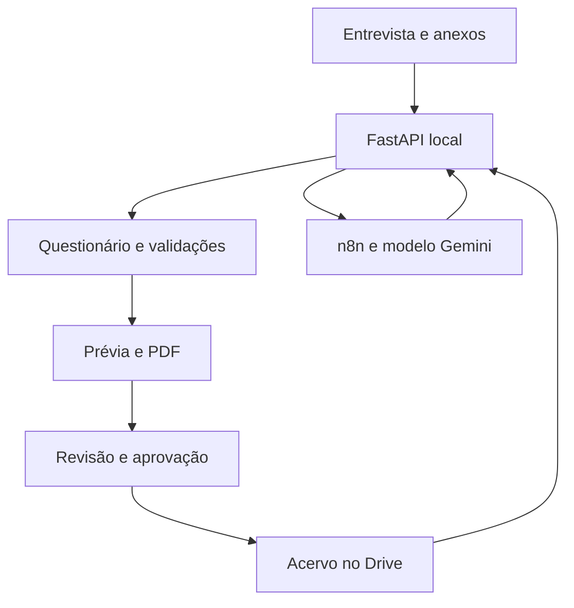
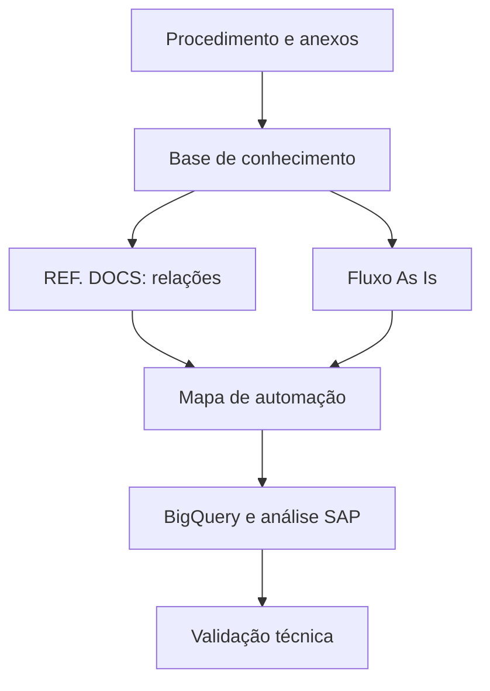
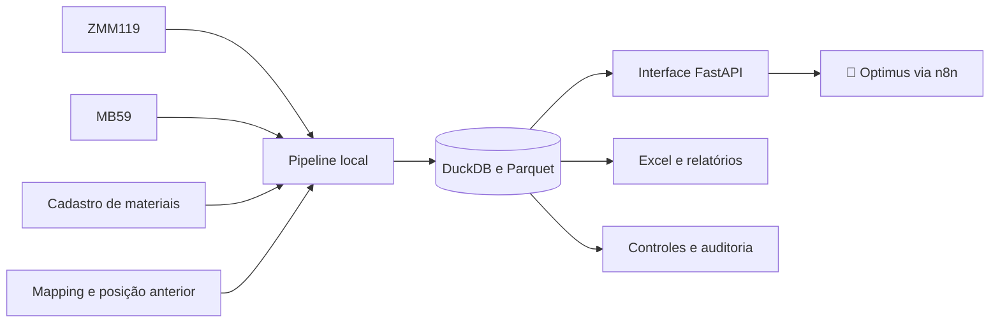

# 🗂️ Projetos

Repositório de projetos desenvolvidos para automatizar processos, organizar dados e criar rotinas auditáveis. Cada projeto fica em uma pasta própria, com código, documentação técnica, instruções de instalação e arquivos necessários para adaptação a outros contextos.

## 📚 Projetos disponíveis

### 🧩 NexxusDoc

Aplicação local para Windows que transforma entrevistas guiadas em procedimentos operacionais. O agente de IA **NexxusDoc** organiza respostas, referências, controles e exceções; o sistema gera o PDF, coordena revisão e aprovação e conecta o acervo a um universo visual de procedimentos. Essa base ajuda a encontrar automações direcionadas por etapa, sistema e evidência. Esta pasta inclui o código e a documentação em uma versão pública sanitizada.

> 🤖 **Agente em destaque:** o workflow n8n usa um AI Agent com o modelo configurado como `gemini-3.6-flash` por um endpoint compatível com OpenAI. A API local prepara contexto de cada rodada, valida campos essenciais e controla a geração. O modelo ajuda a perguntar e redigir; a pessoa responsável revisa e aprova o conteúdo.

#### 📌 O problema

Documentar um processo a partir de conversas e arquivos dispersos dificulta identificar responsáveis, etapas, evidências, controles e contingências. Sem versões e aprovação, um texto novo pode circular sem validação ou perder sua relação com os documentos que o fundamentaram.

#### ✅ A solução

1. A pessoa autenticada inicia uma entrevista ou envia um procedimento antigo para revisão.
2. O agente pergunta uma coisa por vez, usando questionário, contexto da área e referências vinculadas.
3. A aplicação extrai texto dos anexos e procura duplicidades e documentos relacionados no acervo.
4. A prévia mostra as respostas; o backend impede a geração com lacunas essenciais.
5. O sistema monta o PDF com sumário, passos, papéis, riscos, evidências e fontes.
6. Um aprovador habilitado aprova ou solicita ajustes; versões e decisões ficam registradas.
7. O REF. DOCS mostra relações entre processos, documentos, prestador, transações SAP e controles.
8. A consulta ao acervo cita fontes e o mapa reúne oportunidades por etapa, esforço e impacto.
9. Com permissão e integração configuradas, o BigQuery oferece agregados das transações SAP para análise técnica de melhorias.



#### 🤖 IA e fluxo da conversa

O backend controla a sessão e prepara os dados necessários para o workflow. O n8n entrega prompt e contexto ao agente, recebe a pergunta seguinte ou a síntese e devolve o resultado à API. O fluxo usa um endereço de retomada para consultas assíncronas, evitando o limite de duração do proxy da instalação original. O modelo pode sugerir perguntas, apontar lacunas e apoiar consultas; a validação do documento e a autorização de acesso permanecem na aplicação.

O roteiro cobre objetivo, escopo, gatilhos, entradas e saídas, etapas, sistemas, responsáveis, riscos, controles, exceções, evidências, indicadores e potencial de automação. Na revisão, o agente aproveita o documento existente e pergunta apenas o que falta. A arquitetura e os limites estão em [nexxusdoc/docs/ia-e-fluxos.md](nexxusdoc/docs/ia-e-fluxos.md).

#### 🪐 Universo de procedimentos e orquestração

O **REF. DOCS**, acessado pela Visão geral, apresenta as fases da jornada como galáxias e os processos como estrelas. Ao redor de cada processo aparecem POPs, manuais, etapas do prestador, transações SAP e controles. O sistema liga processos que compartilham esses elementos e permite abrir fontes ou iniciar a documentação de uma lacuna. Na versão atual, a visualização usa o catálogo curado da Logística Internacional; as bases reais não estão na publicação.

A entrevista reúne volume, frequência, tempo, tarefas manuais, dados, regras e exceções. O agente associa oportunidades às etapas; o **Fluxo As Is** expõe raias, decisões e pontos de melhoria; o **Mapa de Automação** consolida prioridades, impacto, esforço, pré-requisitos e riscos. O n8n orquestra as chamadas de IA e integrações. As automações propostas ainda exigem avaliação, implementação e validação humana: o mapa não as executa sozinho.



#### 🔎 BigQuery e análise técnica SAP

Para transações registradas no procedimento, uma pessoa autorizada pode consultar pelo n8n os agregados dos últimos 30 dias na **BKPF**, com verificação de presença na **BSEG** e **ACDOCA**. A tela permite ajustar campos, datas e filtros, conferir o SQL gerado e refazer uma consulta de leitura. A IA combina esse resultado com o contexto do POP e prepara uma ficha que compara recursos padrão, jobs, BAPIs, IDocs, Fiori, workflow, carga em massa, scripts SAP GUI em casos específicos, ABAP e alternativas fora do SAP. A ficha pode ser exportada para Excel e deve ser validada pelo time de Tech SAP. Transações sem documento contábil podem não aparecer nessas três tabelas.

#### 🖥️ Páginas do sistema

| Página | Função |
| --- | --- |
| **Visão geral / REF. DOCS** | Pendências, jornada e relações entre processos. |
| **Chat Nexxus** | Criar, revisar e consultar procedimentos com fontes. |
| **Documentos** | Biblioteca, PDF, versões, aprovação e Fluxo As Is. |
| **Automação** | Matriz de oportunidades, BigQuery, análise SAP e exportações. |
| **PGL** | Processos do prestador, fontes, SLA e situação documental. |
| **Budget** | Orçamento e cenários para perfis habilitados. |
| **Configurações** | Perfil, áreas, permissões, workflow e diagnóstico. |

#### 🧩 Principais recursos

- Entrevista guiada, anexos, referências, prévia e validação de campos essenciais.
- PDF com sumário navegável, histórico, links e documentos relacionados.
- Revisão de procedimentos existentes, alerta de duplicidade e consulta ao acervo com fontes.
- Workflow de aprovação por owner ou administrador, com retorno para ajustes.
- Mapa de automação por impacto e esforço, consultas autorizadas ao BigQuery e ficha técnica SAP exportável.
- REF. DOCS para explorar relações entre procedimentos, manuais, prestador, transações e controles.
- Fluxo As Is com etapas, decisões, raias e pontos de melhoria.
- Instalação por usuário, atualização assinada, auditoria e diagnóstico de VPN e sincronização.

#### 🛠️ Tecnologias

**Python** · **FastAPI** · **HTML/CSS/JavaScript** · **n8n** · **Gemini** · **Google Drive** · **PDF** · **openpyxl**

#### 📁 Estrutura

```text
nexxusdoc/
├── app.py                 # API, regras e geração de documentos
├── static/                # interface e módulos visuais
├── workflows/             # agente n8n e prompt
├── questionnaire.json     # roteiro da entrevista
├── instalador_nexus.py    # instalação e atualização
├── nexus_launcher.pyw     # inicialização local
├── docs/                  # arquitetura e segurança da publicação
└── README.md              # funcionamento e configuração
```

#### 📚 Documentação

- [Código, funcionamento e adaptação](nexxusdoc/README.md)
- [Arquitetura da IA e fluxos](nexxusdoc/docs/ia-e-fluxos.md)
- [Conhecimento, REF. DOCS, BigQuery e automação](nexxusdoc/docs/conhecimento-e-automacao.md)
- [Workflow n8n e configuração](nexxusdoc/workflows/README.md)
- [Escopo da versão pública e dados excluídos](nexxusdoc/docs/seguranca.md)

#### 🔐 Reutilização

O código foi copiado de uma pasta corporativa sem modificar a origem. A versão pública troca e-mails, URLs, projetos e identificadores internos por exemplos e exclui credenciais, cadastros, assinaturas, documentos reais, logs e backups. Para executar em outra instalação, configure as integrações e forneça os dados autorizados no ambiente de destino.

---

### 📦 Estoque Contábil

Plataforma local em Python e FastAPI para processar posições contábeis de estoque, automatizar extrações do SAP, consolidar regras de negócio e disponibilizar consultas e análises em uma interface web executada na máquina do usuário. O projeto tem como destaque o agente de IA **Optimus**, integrado ao n8n e ao Google Gemini.

> 🤖 **Optimus em destaque:** o agente responde perguntas sobre competências, valor fiscal, aging, origem, lifecycle, centros, controles e documentação usando contexto validado pela API local. Ele também prepara relatórios, identifica pendências e só executa ações depois de confirmação explícita.

#### O problema

O processo dependia de planilhas pesadas, fórmulas distribuídas e etapas manuais para reunir posição de estoque, movimentos de materiais, cadastros e regras contábeis. Isso aumentava o tempo de processamento e dificultava a rastreabilidade dos resultados.

#### A solução

1. Recebe ou extrai as bases necessárias do SAP.
2. Valida os contratos de colunas e a competência processada.
3. Consolida posição de estoque, movimentos, cadastro de materiais, mapeamentos e posição anterior.
4. Armazena a base compilada localmente em DuckDB.
5. Disponibiliza visão analítica, relatórios, auditoria, diagnóstico e consultas assistidas pelo Optimus.
6. Gera arquivos de saída e evidências rastreáveis por execução.



#### Optimus e n8n

O Optimus é o agente contábil do sistema. A API local monta um contexto validado com KPIs, `run_id`, insights, regras de negócio, Mapping, All Brazil, manual e saúde da instalação; o workflow n8n entrega esse contexto ao Gemini e devolve a resposta para a página do chat. Quando a pergunta exige uma consulta adicional, o agente solicita uma ferramenta local pelo protocolo `[[OPS_ACTION]]`; quando exige alteração ou execução, o sistema apresenta o resumo e aguarda confirmação explícita.

O agente também cria o payload factual para PDF e apresentações, detecta lacunas e indisponibilidades e escreve avisos proativos para administradores. A documentação completa está em [estoque-contabil/docs/optimus.md](estoque-contabil/docs/optimus.md).

#### Principais recursos

- Processamento local de bases contábeis de grande volume.
- Extração assistida de transações SAP com a sessão já autenticada.
- Consolidação por competência com validações de origem e estrutura.
- Mapeamentos editáveis para aging, planta, lifecycle e status operacional.
- Relatórios, exportações e histórico de execução.
- Health Center para diagnóstico do ambiente e das bases.
- Optimus para consultas contábeis apoiadas em evidências da base compilada.
- Instalador versionado para distribuição em outras máquinas.
- Ponte de sincronização para competências compiladas entre instalações.

#### Tecnologias

**Python** · **FastAPI** · **DuckDB** · **Parquet** · **pandas** · **openpyxl** · **SAP GUI Scripting** · **n8n** · **HTML e JavaScript**

#### Estrutura

```text
estoque-contabil/
├── src/                 # aplicação, API, pipeline, integrações e interface
├── tests/               # testes automatizados
├── config/              # fontes, contratos, parâmetros e regras
├── installer/           # criação e manutenção do instalador
├── n8n/                 # workflows e instruções do agente
├── tools/               # utilitários de documentação, build e verificação
├── README.md            # início rápido e operação do projeto
├── ARQUITETURA_FINAL.md # arquitetura e limites de homologação
├── MAPEAMENTO_DADOS.md  # campos, fórmulas e regras mapeadas
└── Especificacao_Tecnico_Documental_Estoque_Contabil.docx
```

#### Documentação

- [Código e início rápido](estoque-contabil/README.md)
- [Especificação técnico documental](estoque-contabil/Especificacao_Tecnico_Documental_Estoque_Contabil.docx)
- [Arquitetura final](estoque-contabil/ARQUITETURA_FINAL.md)
- [Mapeamento de dados](estoque-contabil/MAPEAMENTO_DADOS.md)
- [Manual operacional usado pelo sistema](estoque-contabil/src/ops_contabil/knowledge/manual_sistema.md)
- [Optimus e integração com n8n](estoque-contabil/docs/optimus.md)

#### Reutilização

O projeto foi organizado para permitir adaptação a outra operação, área ou empresa. Os contratos de entrada, caminhos, parâmetros, regras de mapeamento e integrações ficam separados do núcleo de processamento. Credenciais e dados operacionais devem permanecer fora do repositório e ser configurados no ambiente de cada implantação.

---

### 🧭 Vektor

Ecossistema modular em Google Apps Script que reúne governança financeira, análises, automações, páginas operacionais e assistentes de IA. O portal integra frentes de cartão corporativo, Numerário, Contas a Receber/Prosegur, POS, agentes de IA e painéis de Power BI.

A versão pública contém os 19 arquivos do projeto Apps Script e documenta os serviços avançados e bibliotecas associados. IDs, e-mails, URLs internas, política corporativa e dados operacionais foram removidos ou substituídos por configurações de ambiente.

**Tecnologias:** Google Apps Script, JavaScript, HTML/CSS, Google Sheets, Google Drive, Gmail API, BigQuery, Vertex AI e Power BI.

- [Código, módulos e instalação](vektor/README.md)
- [Arquitetura do ecossistema](vektor/docs/arquitetura.md)
- [Módulos e fluxos operacionais](vektor/docs/modulos.md)
- [Dados e integrações](vektor/docs/dados-integracoes.md)
- [Configuração para uma nova implantação](vektor/docs/configuracao.md)
- [Segurança da versão pública](vektor/docs/seguranca.md)

---

### 🛡️ Sistema Prosegur

Pipeline em Python e Google Apps Script para capturar documentos, interpretar PDFs de BOL, CTe-OS, DEM e NFSe, consolidar valores e gerar relatórios auditáveis para a operação Prosegur.

O projeto inclui o parser por tipo documental, banco local, enriquecimento por bases de referência, geração de relatórios Excel, auditoria de lotes, métricas, integração Gmail/Drive e versões legadas do código. PDFs, planilhas, banco, logs e credenciais ficam fora do repositório.

**Tecnologias:** Python, pdfplumber, pandas, openpyxl, SQLite, Google Apps Script, Gmail API e Google Drive.

- [Código, fluxo e instalação](sistema-prosegur/README.md)
- [Arquitetura e contratos de dados](sistema-prosegur/docs/arquitetura.md)
- [Operação passo a passo](sistema-prosegur/docs/operacao.md)
- [Processo operacional e SAP](sistema-prosegur/docs/processo-sap.md)
- [Configuração e implantação](sistema-prosegur/docs/configuracao.md)
- [Segurança e dados excluídos](sistema-prosegur/docs/seguranca.md)

---

### 🧾 SmartSlip

Aplicação web em Google Apps Script para receber comprovantes financeiros, organizar arquivos no Google Drive, extrair informações com Gemini e acompanhar filas, histórico, indicadores, alertas e custos de inteligência artificial.

O projeto oferece uma interface responsiva para computador e celular, controle de acesso por usuário e loja, processamento auditável e persistência em Google Sheets. A versão pública foi sanitizada: não contém a planilha persistente, IDs, e-mails, URLs internas ou dados operacionais.

**Tecnologias:** Google Apps Script, JavaScript, HTML, CSS, Google Sheets, Google Drive, Gemini API e Gmail API.

- [Código, funcionalidades e instalação](smartslip/README.md)
- [Arquitetura e fluxo](smartslip/docs/arquitetura.md)
- [Segurança da versão pública](smartslip/docs/seguranca.md)

---

Desenvolvido por [Rodrigo Lisboa](https://github.com/rodrigolisboa25-create).
