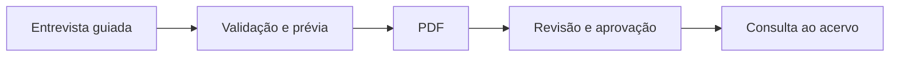

# NexxusDoc

Agente para documentar processos por meio de entrevistas guiadas e gerar procedimentos operacionais em PDF. O aplicativo roda localmente no Windows e organiza a revisão, aprovação e consulta dos documentos.

> Projeto em desenvolvimento. Esta página apresenta o funcionamento e a arquitetura em alto nível. O código operacional, as configurações de implantação e os dados corporativos não são distribuídos neste portfólio.

## O problema

Documentar um processo exige reunir informações de quem o executa, identificar controles e exceções, localizar materiais de apoio e manter as versões consistentes. Quando esse trabalho fica espalhado em arquivos e conversas, a revisão e a rastreabilidade se tornam difíceis.

## A solução

1. O agente conduz uma entrevista com perguntas sobre objetivo, escopo, etapas, responsáveis, evidências, riscos e oportunidades de automação.
2. O usuário vincula documentos e referências usados no processo.
3. O sistema prepara uma prévia e verifica campos essenciais antes de gerar o procedimento.
4. O PDF segue para revisão e aprovação, com histórico de versões e trilha de auditoria.
5. Os documentos aprovados ficam disponíveis para consulta e para contextualizar novas entrevistas.

## Principais recursos

- Entrevistas guiadas e revisão de procedimentos existentes.
- Anexos e referências vinculados aos documentos.
- Verificação de campos obrigatórios e alerta de assuntos relacionados.
- Geração de PDF com sumário e histórico de revisões.
- Fluxo de aprovação com papéis separados.
- Mapa de oportunidades de automação dos processos documentados.
- Consulta ao acervo com indicação das fontes.

## Tecnologias

**Python** · **FastAPI** · **HTML/CSS/JavaScript** · **n8n** · **Google Drive** · **PDF**

## Arquitetura em alto nível

Uma aplicação web local atende o navegador no Windows. O agente conversa com o usuário por meio de um fluxo de IA, enquanto a aplicação valida respostas, gera documentos e administra o processo de revisão. Os arquivos de trabalho são sincronizados no ambiente corporativo.

## Segurança e distribuição

Este repositório público contém apenas esta descrição. Credenciais, URLs internas, controles de acesso, entrevistas, documentos, bases de conhecimento, logs, backups e configurações operacionais permanecem no ambiente autorizado da organização. A divulgação do código depende de uma revisão específica para publicação.
