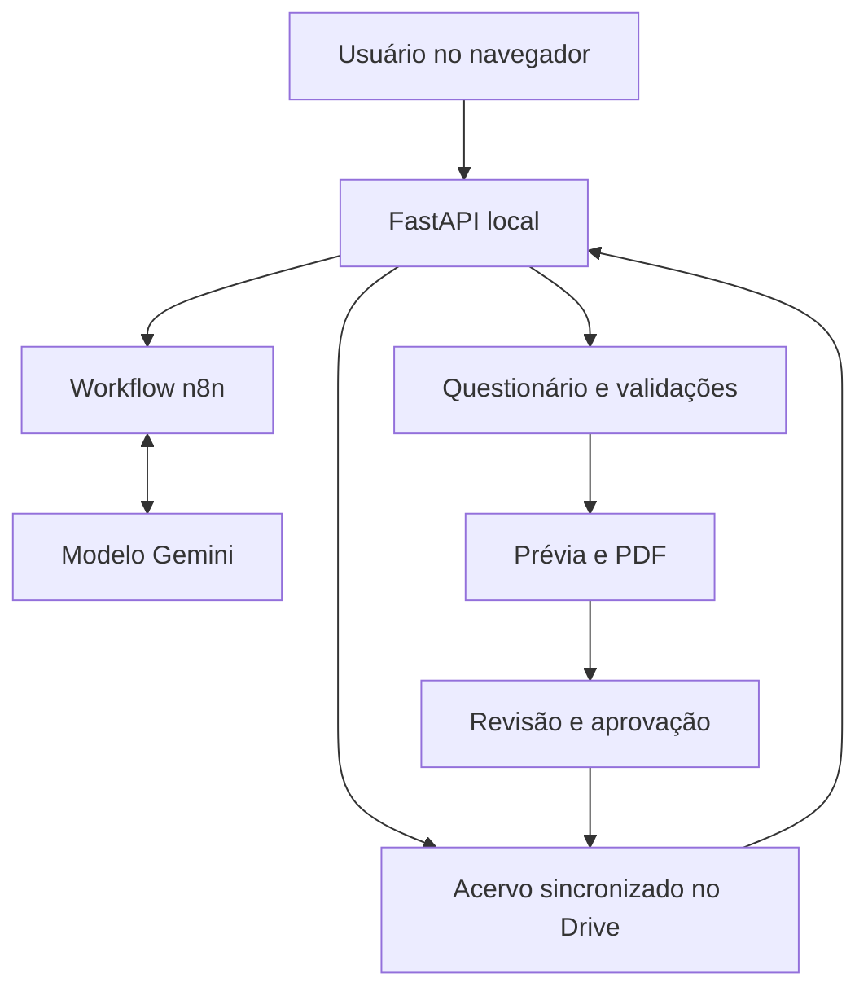
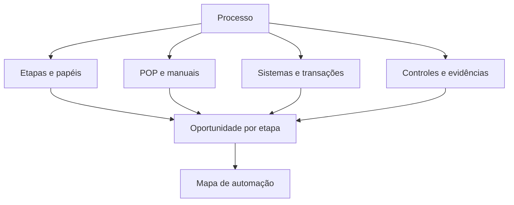
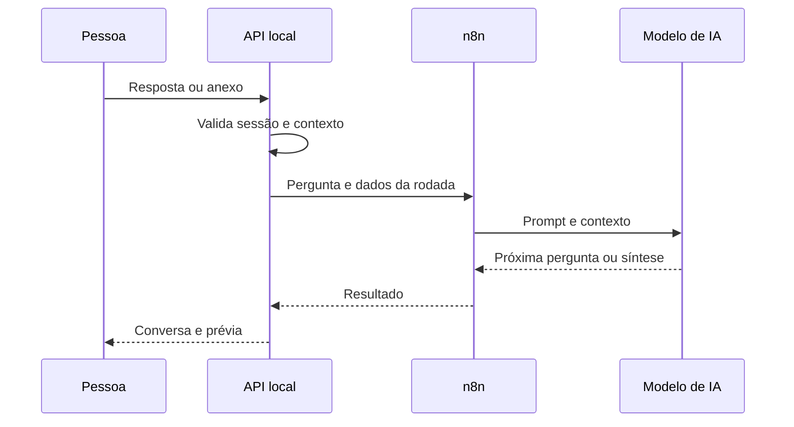
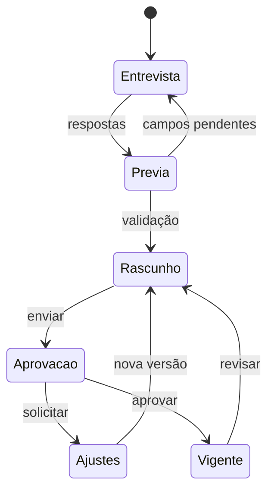

# 🧩 NexxusDoc

**Python · FastAPI · HTML/CSS/JavaScript · n8n · Gemini via endpoint compatível com OpenAI · Google Drive · PDF**

Aplicação local para Windows que transforma entrevistas guiadas em procedimentos operacionais (POPs). O agente de IA **NexxusDoc** conversa com quem executa o processo, coleta etapas, controles e evidências, ajuda a identificar lacunas e produz um documento para revisão humana. A aplicação conecta esse conhecimento em um universo visual de processos e usa as informações reunidas para identificar automações direcionadas. Também administra versões, aprovações e consultas ao acervo.

> Versão pública sanitizada. Credenciais, cadastros, documentos e referências corporativas reais não estão neste repositório. Integrações e bases específicas precisam ser configuradas para outra implantação.

## 📌 O problema

Procedimentos costumam ser descritos em conversas, planilhas e arquivos dispersos. Sem roteiro comum, ficam de fora exceções, responsáveis, evidências, controles, contingências e critérios de aprovação. Uma atualização também pode perder o vínculo com a versão anterior e seus materiais de apoio.

## ✅ A solução

1. A pessoa autenticada escolhe criar um procedimento ou revisar um documento existente.
2. O agente conduz uma entrevista, uma pergunta por vez, usando o questionário e o contexto da área.
3. A aplicação vincula anexos e links, extrai texto admitido e sinaliza duplicidades e documentos relacionados.
4. A prévia acompanha as respostas. O servidor bloqueia a geração quando faltam campos essenciais.
5. O sistema monta o PDF com sumário, etapas, papéis, riscos, evidências e referências.
6. O documento passa por revisão e aprovação; versões e decisões permanecem registradas.
7. O acervo sustenta consultas posteriores com indicação das fontes.
8. As entrevistas alimentam um mapa de oportunidades de automação por impacto e esforço.

**A ideia central:** cada procedimento registra mais do que um texto final. Ele passa a relacionar etapas, sistemas, pessoas, controles, evidências, manuais e outros processos. Essa base de conhecimento dá contexto para o agente fazer perguntas melhores e permite descobrir onde uma automação realmente se encaixa, quais dados ela precisa, o que pode ser integrado e quais validações humanas devem continuar.



## 🪐 REF. DOCS: universo dos procedimentos

Na Visão geral, o **REF. DOCS** apresenta um mapa interativo da jornada de processos. As fases aparecem como galáxias; cada processo é uma estrela; documentos, etapas do prestador, transações SAP e controles aparecem ao redor. Processos são ligados quando compartilham elementos identificados pelo sistema. É possível abrir o procedimento, o manual ou uma fonte vinculada e iniciar a documentação de um processo ainda sem POP.

Na implementação atual, esse universo usa o catálogo curado da **Logística Internacional** e os procedimentos criados no NexxusDoc. Cruza títulos e palavras-chave, documentos existentes, referências e vínculos operacionais. O mapa depende dessas bases internas, excluídas da cópia pública; sem elas, a visualização não representa o universo real da área.



## ⚙️ Da base de conhecimento à automação

A entrevista pede volume, frequência, tempo gasto, tarefas manuais, formatos dos dados, regras e exceções. O agente usa essas respostas para propor oportunidades por etapa, com tipo de solução, economia estimada, complexidade, pré-requisitos, riscos e controles. O **Mapa de Automação** reúne as oportunidades, permite filtrar por área e unidade, mostra uma matriz de impacto × esforço e exporta a análise para Excel. Há também uma visão de transações SAP e consultas técnicas quando as integrações da implantação estão configuradas.

O sistema **orquestra a descoberta e a preparação**: reúne fontes, liga processos, mantém o contexto da entrevista, produz o diagnóstico e encaminha o trabalho para análise e decisão. O n8n orquestra as chamadas do agente e alguns fluxos de integração e notificação. **As automações sugeridas não são implantadas ou executadas automaticamente pelo Mapa**; cada proposta precisa de validação técnica, acesso aprovado, implementação e medição do resultado.

O **Fluxo As Is** pode representar etapas, decisões, raias, sistemas e pontos de melhoria a partir do procedimento. Isso ajuda a localizar gargalos e dependências antes de desenhar um fluxo futuro. Veja [como o conhecimento alimenta a automação](docs/conhecimento-e-automacao.md).

### 🔎 Transações SAP e dados no BigQuery

Quando o procedimento registra transações SAP, a página **Automação** pode consultar dados do lake por meio do n8n e do BigQuery, desde que o usuário tenha a permissão e a integração esteja configurada. A consulta padrão olha os **últimos 30 dias**: identifica documentos por transação na **BKPF** e verifica a presença correspondente na **BSEG** e na **ACDOCA**. A tela mostra contagens e datas agregadas, não linhas financeiras individuais; os resultados por transação são reaproveitados em cache por até sete dias.

Em **Ajustar consulta**, a pessoa autorizada escolhe colunas, campo de data, período e filtros disponíveis, visualiza o SQL montado pelo servidor e refaz uma consulta somente de leitura. Isso ajuda a verificar volume e disponibilidade de dados no lake antes de propor integrações. Uma transação que não gera documento contábil pode não aparecer nessas três tabelas; ausência de resultado **não significa** ausência de dados no SAP.

### 🧠 Análise técnica de melhorias no SAP

O NexxusDoc cruza a função da transação no procedimento com os agregados disponíveis e pede ao agente uma ficha técnica para cada transação: módulo, uso no processo, tabelas relevantes, pré-requisitos, riscos, controles e perguntas para validação. A análise compara alternativas como recursos padrão do SAP, jobs com variante, BAPIs, interfaces/IDocs, apps Fiori, workflow, carga em massa, desenvolvimento ABAP, script SAP GUI em casos específicos e automações fora do SAP com dados do BigQuery. A ficha pode ser exportada para Excel e levada ao time de **Tech SAP**.

Essas opções são **hipóteses técnicas**, não soluções ativadas pelo sistema. Objetos SAP e ganhos precisam ser confirmados no ambiente, com atenção a autorização, segregação de funções, rastreabilidade e impacto fiscal. Veja [o fluxo completo entre conhecimento, BigQuery e melhorias](docs/conhecimento-e-automacao.md).

## 🤖 NexxusDoc: agente de IA

O [workflow n8n](workflows/normas_procedimentos_n8n.json) usa um nó **AI Agent** e um nó **OpenAI Chat Model** apontado, na instalação original, para o modelo configurado como `gemini-3.6-flash` por um endpoint compatível. A cópia publicada não inclui a credencial nem o endpoint da organização. A seleção do modelo pertence à instância n8n; a API local controla a sessão, valida respostas e gera o documento.

O [prompt](workflows/system_message_nexxusdoc.md) orienta a entrevista; o [questionário](questionnaire.json) define campos e perguntas. A API prepara o contexto com referências, anexos e documentos relacionados. O modelo devolve a próxima pergunta ou síntese; o backend decide se há dados suficientes para gerar o PDF. A IA auxilia a redação e a consulta, mas o conteúdo exige revisão por pessoas autorizadas.

### Como a conversa funciona



O workflow usa uma retomada assíncrona: devolve rapidamente um endereço de resultado e a aplicação consulta até a resposta ficar pronta. Isso contorna o limite de duração do proxy da instalação original. A interface permite tentar novamente após falha sem perder a mensagem.

### O que ele faz

- Pergunta objetivo, escopo, gatilhos, entradas e saídas, passos, responsáveis, sistemas, regras e evidências.
- Investiga controles, exceções, contingências, riscos, indicadores e materiais de apoio.
- Ao revisar um POP existente, aproveita o texto recebido e pergunta o que falta para o novo padrão.
- Sugere documentos relacionados e avisa sobre outro procedimento do mesmo tema.
- Usa referências de mercado como ponto de partida para perguntas, sempre sujeitas à confirmação.
- Consulta o acervo com fontes e levanta esforço, frequência e volume para análise de automação.

## 🔄 Do rascunho ao documento vigente



O aprovador deve ser um owner ou administrador ativo. O modo obrigatório ou opcional é configurável. O histórico registra comentários, versões e decisões. O texto redigido pelo modelo não se torna vigente sem o fluxo aplicável.

## 🧩 Principais recursos

- Interface local com Visão geral, Chat Nexxus, Documentos e Configurações.
- Identificação pelo e-mail corporativo vinculado ao UPN do Windows, com perfis master, owner e usuário.
- Anexos de documentos, planilhas e imagens, com limites e extração de texto.
- Prévia durante a entrevista e validação de campos essenciais.
- PDF com capa, sumário navegável, links, histórico e documentos relacionados.
- Revisão de POPs existentes, consulta assistida e alerta de duplicidade.
- Aprovação com segregação de papéis, retorno para ajustes e auditoria.
- Mapa de automação com exportação para Excel.
- Instalador por usuário, atualização assinada, backup de cadastro, diagnóstico de VPN e sincronização.

## 🖥️ Páginas do sistema

| Página | O que a pessoa encontra |
| --- | --- |
| **Visão geral** | Pendências, atalhos e acesso ao REF. DOCS, o universo visual dos procedimentos. |
| **Chat Nexxus** | Criar procedimento, enviar/revisar documento existente e fazer consultas gerais com fontes. |
| **Documentos** | Biblioteca, versões, PDFs, aprovação, lista mestra e Fluxo As Is. |
| **Automação** | Oportunidades por processo, matriz impacto × esforço, consultas autorizadas ao BigQuery, análise técnica das transações SAP e exportação. |
| **PGL** | Catálogo de processos do prestador na jornada de importação, com documentos e situação de cada processo. |
| **Budget** | Cenários e análises de orçamento, conforme permissão do usuário. |
| **Configurações** | Perfil, notificações, áreas, acessos, aprovação, saúde do sistema e instalador, conforme o perfil. |

O REF. DOCS abre como uma visualização na Visão geral. O fluxo de aprovação é acessado a partir dos documentos; alguns recursos aparecem somente para perfis autorizados. O catálogo PGL e as visualizações da jornada dependem dos dados específicos da implantação.

## 🛠️ Componentes

| Arquivo | Responsabilidade |
| --- | --- |
| [`app.py`](app.py) | API, sessões, entrevistas, documentos, PDF, acervo e aprovação. |
| [`static/`](static/) | Interface e módulos de fluxo, orçamento e apresentação. |
| [`budget_engine.py`](budget_engine.py) | Motor de orçamento e importação/exportação. |
| [`questionnaire.json`](questionnaire.json) | Roteiro estruturado de perguntas. |
| [`workflows/`](workflows/) | Workflow n8n, prompt e instruções. |
| [`instalador_nexus.py`](instalador_nexus.py) e [`nexus_launcher.pyw`](nexus_launcher.pyw) | Instalação, atualização e inicialização. |
| [`assinatura.py`](assinatura.py) | Verificação de publicações e cadastro assinados. |
| [`modelos_referencias_por_area.json`](modelos_referencias_por_area.json) | Modelos de referência iniciais. |
| [`tools/build_manuais.py`](tools/build_manuais.py) | Geração de catálogo a partir de manifesto privado configurável. |

## 📁 Estrutura

```text
nexxusdoc/
├── app.py                       # servidor e regras
├── budget_engine.py             # orçamento
├── assinatura.py                # verificação de assinaturas
├── instalador_nexus.py          # instalação e atualização
├── nexus_launcher.pyw           # inicialização
├── questionnaire.json           # entrevista
├── modelos_referencias_por_area.json
├── static/                      # interface e recursos visuais
├── workflows/                   # agente e prompt
├── tools/                       # utilitário de documentação
├── docs/                        # arquitetura e segurança
├── .env.example                 # parâmetros de exemplo
└── requirements.txt
```

## 🚀 Adaptação e instalação

1. Em Windows, crie um ambiente Python compatível com [`requirements.txt`](requirements.txt).
2. Copie `.env.example` para `.env` e configure a pasta compartilhada, e-mail master, segredo de sessão e URL n8n.
3. Importe o workflow no n8n e configure suas próprias credenciais de modelo, Gmail, Drive e BigQuery conforme os nós usados.
4. Configure o identificador da pasta sincronizada no instalador e a ponte do Drive quando necessários.
5. Providencie cadastros e bases curadas específicos em ambiente restrito; eles foram excluídos desta cópia.

**A cópia pública não é um pacote de produção pronto.** Caminhos, IDs, projeto de dados e endereços foram substituídos por exemplos. Sua implantação precisa preencher esses parâmetros e validar permissões.

## 🔐 Segurança

A pasta original no Drive não foi alterada. Chaves privadas, assinaturas, usuários, entrevistas, logs, backups, PDFs e conhecimento corporativo real foram excluídos. E-mails, URLs internas, IDs e projetos de dados foram substituídos na cópia publicada. A autenticação pelo UPN pressupõe um Windows gerenciado e requer avaliação na implantação.

Leia [arquitetura da IA](docs/ia-e-fluxos.md), [conhecimento e automação](docs/conhecimento-e-automacao.md) e [escopo da versão pública](docs/seguranca.md).

Desenvolvido por [Rodrigo Lisboa](https://github.com/rodrigolisboa25-create).
