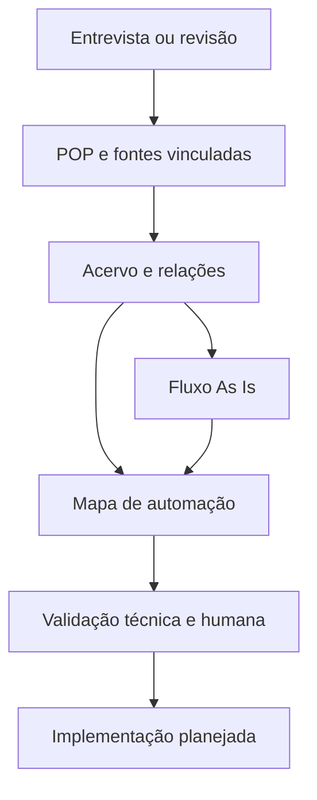
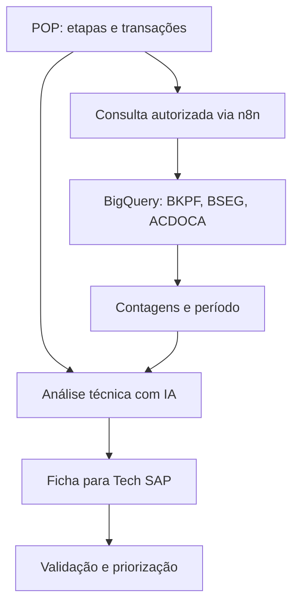

# 🪐 Conhecimento conectado e automações direcionadas

O NexxusDoc busca transformar a documentação de processos em uma base consultável para melhoria contínua. O procedimento reúne o passo a passo e também registra quem faz, quais sistemas usa, quais evidências deixa, que controles aplica, onde ocorrem exceções e quanto esforço a operação consome. Essas relações dão contexto para encontrar oportunidades específicas, em vez de propor automação apenas pelo nome do processo.

## Da entrevista ao diagnóstico

1. A entrevista pergunta etapas, papéis, sistemas, dados, volume, tempo, tarefas manuais, regras, exceções, controles e evidências. Na revisão, aproveita o que já consta no documento.
2. O procedimento gerado vincula anexos, links, manuais e documentos relacionados. O acervo apoia consultas posteriores com indicação das fontes.
3. A análise de automação associa propostas às etapas: tipo de solução, potencial, horas mensais estimadas, complexidade, pré-requisitos e riscos.
4. O Fluxo As Is expõe sequência, decisões, raias e pontos de melhoria com base no que está documentado. A pessoa revisa o desenho e as hipóteses.
5. O Mapa de Automação consolida oportunidades, filtros, matriz de prioridade e exportação. Com permissão e integração configuradas, consulta agregados do BigQuery ligados às transações SAP do processo e prepara fichas técnicas para avaliação.

Estimativas dependem das respostas da equipe e precisam ser conferidas antes de priorizar ou prometer ganhos.

## REF. DOCS

O universo dos procedimentos organiza a jornada da área em fases, processos e vínculos. Na implementação atual, é específico da Logística Internacional. Ele combina um catálogo curado de processos com POPs criados no NexxusDoc e manuais existentes. A interface usa a metáfora de galáxias para fases, estrelas para processos e elementos ao redor para prestador, transações e controles.

O backend associa registros por semelhança de nome e palavras-chave, identifica manuais pelo título ou código e cria ligações entre processos que compartilham elementos. A relação visual é uma ajuda à navegação e à investigação: duas estrelas conectadas não provam, por si, uma dependência formal entre processos. A apresentação da jornada também aponta etapas e a situação da documentação de cada uma.

## Páginas e papel de cada uma

| Página | Papel na cadeia de conhecimento |
| --- | --- |
| Visão geral e REF. DOCS | Explorar a jornada, encontrar lacunas documentais e abrir processos relacionados. |
| Chat Nexxus | Capturar conhecimento, anexar fontes, revisar procedimentos e consultar o acervo. |
| Documentos | Revisar, aprovar, versionar e consultar PDFs; examinar o Fluxo As Is. |
| Automação | Reunir e priorizar oportunidades por processo, etapa, esforço e impacto; examinar transações SAP, BigQuery e fichas técnicas. |
| PGL | Relacionar processos do prestador, SLA, fontes e documentos da área. |
| Budget | Examinar cenários orçamentários para usuários autorizados. |
| Configurações | Administrar áreas, perfis, workflow, instalação, notificações e diagnóstico. |

## O que é orquestrado hoje

O n8n coordena o webhook, a chamada ao modelo e ramificações de integração. A API local controla sessão, contexto, validação, documentos, permissões e resultados da entrevista. A documentação alimenta o diagnóstico de automação e o fluxo de revisão. O sistema **não executa automaticamente** os projetos de automação que aparecem no mapa; desenho técnico, aprovações e implantação continuam como etapas próprias.

As bases corporativas que tornam o REF. DOCS e as consultas reais possíveis não foram publicadas. Para outra área, é necessário configurar o catálogo, as fontes, as permissões e as integrações autorizadas.

## 🖥️ Resumo executivo com LLM local

O Mapa de Automação permite ao **administrador master** gerar um texto executivo para cada oportunidade. A aplicação monta um JSON curto com o processo, a etapa, a solução proposta, o esforço, a economia estimada, os pré-requisitos e os riscos já documentados. Envia esse contexto ao **Qwen3.5:4b** pelo **Ollama na própria máquina**, usando a API local de chat. O modelo redige o resumo para gestores e não deve criar números ou fatos ausentes.

Essa redação local não passa pelo workflow n8n e não requer VPN. O endereço do Ollama é limitado a `127.0.0.1` ou `localhost`. Somente o master pode iniciar a geração, mas o texto produzido é guardado em `resumos_executivos/` na pasta compartilhada e fica disponível para leitura dos demais usuários. Se o Ollama ou o modelo não estiverem disponíveis, a geração informa o motivo. O resumo é marcado como desatualizado quando os dados da oportunidade mudam.

O papel da Qwen aqui é **comunicar uma oportunidade já levantada**. A entrevista, a redação dos POPs e a análise técnica SAP usam o fluxo de IA orquestrado pelo n8n. Antes de apresentar uma estimativa à gestão, é preciso conferir tanto os dados de origem quanto a redação final.

## BigQuery e análise das transações SAP

O sistema extrai até 15 códigos de transação informados ou identificados no procedimento; o autor, owner ou master pode ajustar a lista. A consulta padrão procura documentos dos últimos 30 dias na BKPF e verifica sua presença na BSEG e ACDOCA. Retorna contagens, empresas, tipos de documento e datas agregadas. O resultado por transação tem cache de sete dias para evitar repetir consultas extensas. Quem tem permissão de BigQuery pode escolher campos, data, período e filtros autorizados, ver a prévia do SQL e executar uma consulta ajustada de leitura.

A IA usa o contexto do POP e os agregados para comparar opções de melhoria: recurso padrão, job com variante, BAPI, IDoc/interface, Fiori, workflow, carga em massa, script SAP GUI quando houver repetição de tela documentada, desenvolvimento ABAP ou integração fora do SAP. A ficha pede objetos envolvidos, pré-requisitos, esforço, ganhos esperados, riscos, controles e perguntas para o time de Tech SAP. Pode ser exportada em Excel.

BKPF, BSEG e ACDOCA não cobrem todas as transações: uma operação sem documento contábil pode ter seus dados em outras tabelas. A análise deve indicar essa limitação e nunca concluir que não há dados apenas por não encontrar lançamentos nessas três fontes. Nomes de objetos, viabilidade e ganhos estimados exigem validação técnica e operacional antes de qualquer implementação.
