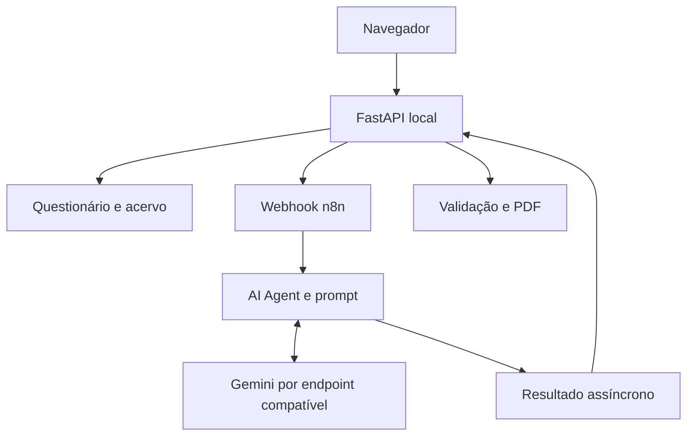
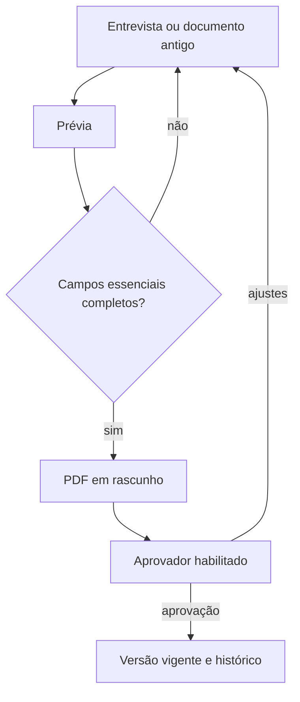

# 🤖 IA e fluxos do NexxusDoc

## Arquitetura da entrevista

O navegador conversa com a API FastAPI local. O backend confere a sessão, compõe um contexto limitado a partir do questionário, cadastro da área, anexos e documentos relacionados, e chama o workflow n8n. O nó de agente usa um modelo de linguagem para formular perguntas e sintetizar respostas. A API valida o resultado antes de gerar ou atualizar qualquer documento.

O modelo configurado no export original do n8n é `gemini-3.6-flash` no nó **OpenAI Chat Model**. Isso descreve a configuração do workflow, não uma dependência fixa do código. O operador deve apontar o nó para um endpoint e credencial aprovados. A pesquisa web opcional depende de suporte do endpoint e do modelo e deve ser verificada antes da ativação.

## Contexto e limites

- O questionário pede objetivos, escopo, etapas, papéis, controles, riscos, evidências e perguntas sobre automação.
- Anexos admitidos têm limites: documentos até 10 MB cada; imagens até 2 MB cada e 8 MB no total; até 20 referências por entrevista. O texto extraído tem limite total de 120 mil caracteres.
- O agente pode receber trechos extraídos, contexto de área e documentos relacionados. A base inteira de arquivos não é enviada em bloco em cada rodada.
- Na consulta ao acervo, a resposta deve indicar as fontes. O usuário verifica a adequação do conteúdo e o aprovador decide sobre vigência.
- Campos essenciais sem resposta definitiva e excesso de respostas a confirmar bloqueiam a geração pelo servidor.

## Revisão e aprovação

O aprovador é um owner ou administrador ativo, com regra de segregação entre autor e aprovador salvo exceção prevista para o master. A opção de exigir aprovador é configurável. O backend registra decisões, versões e auditoria.

## Workflow importável

[`workflows/normas_procedimentos_n8n.json`](../workflows/normas_procedimentos_n8n.json) contém o webhook, validação de entrada, agente, modelo, resposta assíncrona e nós opcionais de e-mail, Drive e consulta a dados. O export público foi desativado e teve referências de credenciais e IDs de implantação removidos. Consulte [`workflows/README.md`](../workflows/README.md) e configure cada serviço antes de ativá-lo.
