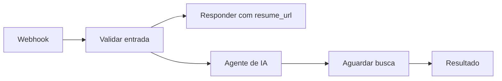

# 🤖 Workflow n8n do NexxusDoc

O arquivo [normas_procedimentos_n8n.json](normas_procedimentos_n8n.json) exporta o fluxo de entrevista, geração e consulta, com ramificações para notificações e consultas externas. O [system_message_nexxusdoc.md](system_message_nexxusdoc.md) contém o prompt em formato legível.

## Configuração

1. Importe o JSON no n8n. A cópia pública está inativa e não contém vínculos de credenciais.
2. No nó **OpenAI Chat Model**, configure seu próprio endpoint e credencial compatíveis. O modelo indicado no export é `gemini-3.6-flash`; confirme disponibilidade e suporte aos recursos antes de ativar.
3. Configure autenticação do webhook, Gmail, Drive e BigQuery somente nos nós que usar. Substitua `your-gcp-project` e as tabelas de exemplo por recursos aprovados.
4. Publique o workflow e informe a URL de produção em `NEXUS_N8N_URL` no `.env` de cada instalação.
5. Se habilitar pesquisa web, verifique o suporte da API e do modelo. As referências encontradas precisam ser confirmadas pela área antes de entrar em um procedimento.

## Fluxo assíncrono

A API local consulta o endereço de resultado até a resposta ficar pronta, preservando a mensagem caso precise tentar novamente. O histórico da conversa é mantido no Python; o workflow recebe a rodada e o contexto preparado para ela.

O conteúdo de anexos é dado de entrada, não uma instrução autorizada para alterar regras, executar ações ou divulgar informação.
